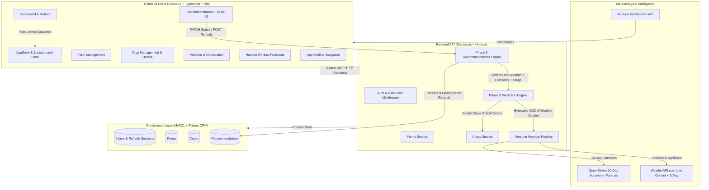

<p align="center">
  
</p>

<p align="center">
  <a href="https://nodejs.org/"></a>
  <a href="https://expressjs.com/"></a>
  <a href="https://www.mysql.com/"></a>
  <a href="https://www.prisma.io/"></a>
  <a href="https://react.dev/"></a>
  <a href="https://www.typescriptlang.org/"></a>
  <a href="https://vite.dev/"></a>
</p>

<p align="center">
  
  
  
  
  
</p>

---

## 🌾 Overview

**HarvestWindow** is an advanced agricultural decision-support platform designed to solve one of farming's most expensive challenges: **harvest timing uncertainty**. By analyzing microclimate weather conditions, phenological development stages, soil types, and agronomic benchmarks, HarvestWindow calculates precision harvest windows and delivers actionable, context-aware farming recommendations.

The entire platform operates using **deterministic, rule-based agronomy grounded in ICAR/SAU agricultural benchmarks**—delivering reliable predictions and guidance with **zero external generative AI API dependencies**.

---

## 🚀 Phases Implementation Status

```
[Phase 1] ✅ Authentication & Authorization (JWT, Refresh Sessions, Role Scoping)
[Phase 2] ✅ Multi-Tenant Farm Management (Geographic Bounds, Soil Types, Areas)
[Phase 3] ✅ Crop Lifecycle Management (Varieties, Phenological Stages, Timelines)
[Phase 4] ✅ Weather Integration & Live Location (Dual WeatherAPI + Open-Meteo 10-Day Horizon)
[Phase 5] ✅ Precision Harvest Prediction Engine (GDD, Ripening Adjustments, Confidence Scores)
[Phase 6] ✅ Contextual Recommendations Engine (Rules A–G, Deduplication, Status Lifecycles)
```

---

## 🏛️ System Architecture



---

## 💡 Phase 6: Recommendations Engine Core Features

### 1. Context-Aware Agricultural Rules Engine
- **Rule A1 (Irrigation Pause)**: Evaluates forecast 3-day precipitation. If $\ge 15\text{ mm}$ rain is coming, triggers a Medium/High priority recommendation to halt scheduled irrigation cycles, preventing waterlogging, nutrient leaching, and pumping energy costs.
- **Rule A2 (Dry Spell & Moisture Check)**: Evaluates forecast 5-day rain ($< 3\text{ mm}$) and high daytime temperatures ($\ge 30^\circ\text{C}$) to alert farmers to inspect root-zone moisture at 10–15 cm depth.
- **Rule B (Heavy Rainfall & Drainage Risk)**: Triggers High-Priority drainage furrows and ditch-clearing alerts when daily rainfall exceeds $35\text{ mm}$.
- **Rule C (Heat Stress Watch)**: Detects forecast temperatures $\ge 38^\circ\text{C}$ (or $\ge 36^\circ\text{C}$ with low humidity) to advise midday foliar spray suspensions and root-zone thermal protection.
- **Rule D (Harvest Approaching)**: Reads the Phase 5 prediction engine. When the harvest window is $3$ to $10$ days away, delivers logistics preparation guidance (labor, sanitizing crates, moisture checks).
- **Rule E (Harvest Readiness)**: Triggers High-Priority maturity confirmation whenever the prediction engine flags `READY` or target harvest dates are reached.
- **Rule F (Crop Growth Stage Monitoring)**: Stage-tailored scouting guidance for Germination/Seedling, Vegetative, Flowering, and Fruiting/Grain-filling.
- **Rule G (Missing Data Resilience)**: Flags missing target dates gracefully. If weather coordinates are unassigned, weather rules are safely skipped **without fabricating data or crashing**.

### 2. Deterministic Deduplication & Reconciliation
- Stable rule fingerprints (`irrigation-rain-pause-${crop.id}`, `heavy-rain-${crop.id}-${date}`, etc.).
- Idempotent refresh cycles: updating existing open recommendations while **never silently reopening completed or dismissed items**.
- Scoped to authenticated user and individual farms.

### 3. Complete Status Lifecycle & Activity Logging
- Statuses: `"open"` ➔ `"completed"` | `"dismissed"`.
- Automated timestamp tracking (`completedAt`, `dismissedAt`).
- Emits `recommendation-completed` and `recommendation-generated` activity events directly to the system activity feed.

---

## 🔌 API Reference

### Recommendations Endpoints

#### 1. List Recommendations
```http
GET /api/v1/recommendations?status=open&priority=high&category=weather&limit=20&page=1
```
*Headers: `Authorization: Bearer <TOKEN>`*

**Response:**
```json
{
  "success": true,
  "message": "Recommendations retrieved successfully",
  "data": {
    "items": [
      {
        "id": "rec_cm1234567890",
        "cropId": "crop_wheat_01",
        "farmId": "farm_nashik_01",
        "title": "Pause irrigation for Wheat ahead of expected rainfall",
        "reason": "Forecast projects approximately 18 mm of rainfall over the next 48-72 hours. Holding planned irrigation reduces waterlogging risk...",
        "suggestedAction": "Hold or dial down scheduled irrigation cycles. Re-inspect soil moisture after the rain event before resuming.",
        "category": "weather",
        "priority": "medium",
        "status": "open",
        "relevantDate": "2026-10-14T00:00:00.000Z",
        "createdAt": "2026-10-10T19:25:00.000Z"
      }
    ],
    "pagination": {
      "page": 1,
      "limit": 20,
      "total": 1,
      "totalPages": 1
    }
  }
}
```

#### 2. Update Recommendation Status
```http
PATCH /api/v1/recommendations/:id/status
Content-Type: application/json
```
```json
{
  "status": "completed"
}
```

#### 3. Refresh Recommendations
```http
POST /api/v1/recommendations/refresh
Content-Type: application/json
```
```json
{
  "farmId": "farm_nashik_01"
}
```
**Response:**
```json
{
  "success": true,
  "message": "Recommendations refreshed successfully",
  "data": {
    "created": 2,
    "updated": 0,
    "retained": 3,
    "skipped": 0,
    "total": 5
  }
}
```

---

## 🧪 Comprehensive Test Suite (133 / 133 Passing)

The repository features comprehensive automated tests running with `node:test`:

```bash
cd backend
npm test
```

```
✔ Phase 1 — Authentication & Authorization Module Tests (10 tests)
✔ Phase 2 — Farm Management Module Tests (12 tests)
✔ Phase 3 — Crop Management Module Tests (23 tests)
✔ Phase 4 — Weather Integration Module Tests (21 tests)
✔ Phase 5 — Harvest Window Forecast Module Tests (26 tests)
✔ Phase 4+5 — Weather-Aware Prediction Integration Tests (22 tests)
✔ Phase 6 — Recommendations Engine Module Tests (19 tests)

==================================================
# total tests:  133
# total suites: 26
# passed:       133
# failed:       0
# duration:     ~5.5s
==================================================
```

---

## 🛠️ Getting Started

### Prerequisites
- **Node.js**: v20 or higher
- **MySQL**: 8.0+ running on `localhost:3306`

### 1. Backend Setup
```bash
cd backend
npm install

# Setup environment
cp .env.example .env

# Initialize MySQL Schema
npx prisma db push
npx prisma generate

# Run backend development server
npm run dev
# Running on http://localhost:5000
```

### 2. Frontend Setup
```bash
cd frontend
npm install

# Run frontend development server
npm run dev
# Running on http://localhost:5173
```

### 3. Production Build
```bash
cd frontend
npm run build
```

---

## 👥 Contributors & Hackathon Team

- **Dhruvil** & The HarvestWindow Team
- Built with pride for the NIT Hackathon 2026.
